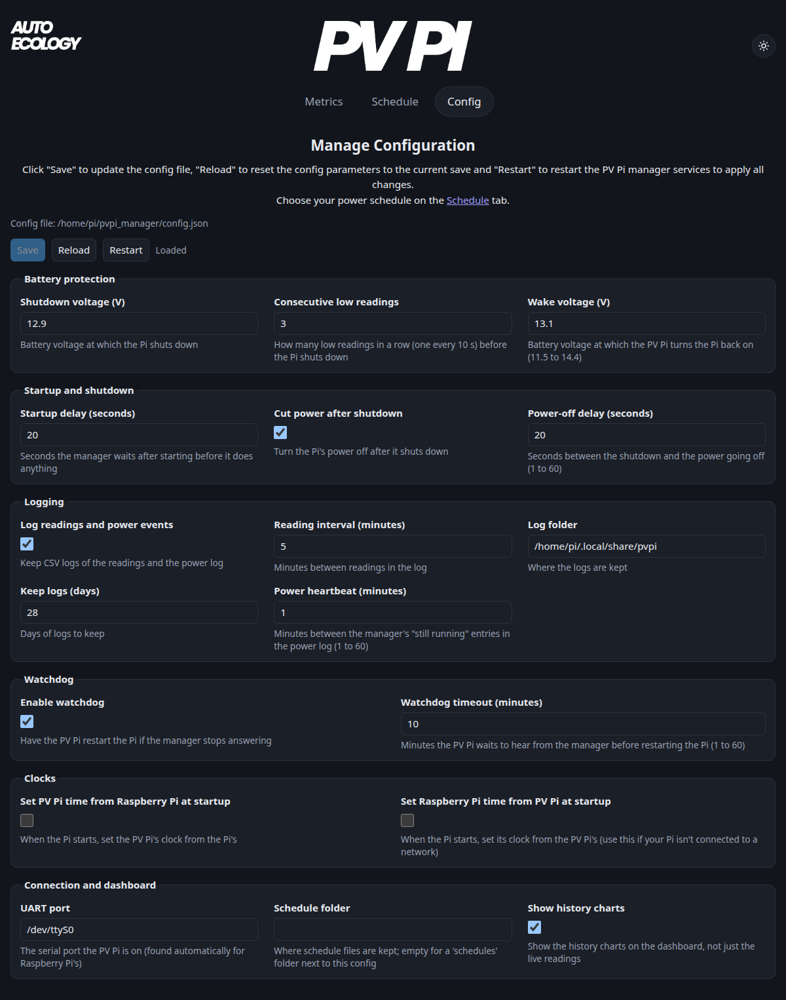

[Home](Home.md)

# Configuration

`pvpi install` creates a `config.json` with the default settings: in the pvpi_manager folder if you cloned the repo, or in `~/.config/pvpi/` if you installed with pip (`pvpi install --config <file>` puts it elsewhere).

To see which file your services use:

```shell
uv run pvpi config-path
```

You can edit it through the **Config** tab on the [dashboard](Services-and-dashboard.md):

- **Save** checks your changes and writes them to the config file.
- **Reload** discards unsaved edits and loads the saved settings.
- **Restart** restarts the PV Pi services to apply your saved settings.

If a setting can't be used, the page tells you why. Choose your power schedule on the **Schedule** tab.



Editing the file by hand? Run `uv run pvpi restart` afterwards (schedule changes don't need a restart).

<!-- options -->
| Option | Default | What it's for |
|---|---|---|
| `uart_port` | set automatically | The serial port the PV Pi is on (found automatically for Raspberry Pi's) |
| `log_period` | `5` | Minutes between readings in the log |
| `startup_delay` | `20` | Seconds the manager waits after starting before it does anything |
| `low_bat_volt` | `12.9` | Battery voltage at which the Pi shuts down |
| `low_bat_readings` | `3` | How many low readings in a row (one every 10 s) before the Pi shuts down |
| `wake_up_volt` | `13.2` | Battery voltage at which the PV Pi turns the Pi back on (11.5 to 14.4) |
| `power_off_on_shutdown` | `true` | Turn the Pi's power off after it shuts down |
| `power_off_delay` | `20` | Seconds between the shutdown and the power going off (1 to 60) |
| `schedule` | `null` | The schedule in use (its file name); empty to stay on all the time |
| `schedules_dir` | `null` | Where schedule files are kept; empty for a 'schedules' folder next to this config |
| `log_pvpi_stats` | `true` | Keep CSV logs of the readings and the power log |
| `data_log_path` | set automatically | Where the logs are kept |
| `keep_for_days` | `7` | Days of logs to keep |
| `heartbeat_mins` | `1` | Minutes between the manager's "still running" entries in the power log (1 to 60) |
| `enable_watchdog` | `false` | Have the PV Pi restart the Pi if the manager stops answering |
| `watchdog_period_mins` | `2` | Minutes the PV Pi waits to hear from the manager before restarting the Pi (1 to 60) |
| `time_pi2mcu` | `false` | When the Pi starts, set the PV Pi's clock from the Pi's |
| `time_mcu2pi` | `false` | When the Pi starts, set its clock from the PV Pi's (use this if your Pi isn't connected to a network) |
| `full_dashboard` | `true` | Show the history charts on the dashboard, not just the live readings |
<!-- /options -->

To update this table after changing an option: `uv run python scripts/gen_config_docs.py`.

Next: [Commands](Commands.md)
