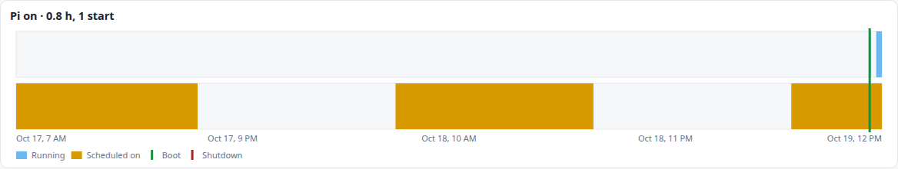

# Power log

The power log shows when your Pi was on. With `log_pvpi_stats` on, the manager writes one CSV a day to the `power` folder inside `data_log_path`, kept for `keep_for_days` like the readings.

Each row has a `Timestamp`, an `Event`, a `Reason` and the `Boot time` it belongs to:

- `boot`: your Pi started
- `running`: the manager is still running (every `heartbeat_mins`, 1 minute by default)
- `shutdown`: the manager shut your Pi down, because of the `schedule` or a `low battery`

A boot with no `shutdown` ended unexpectedly, after its last `running` entry: the power was cut, or the Pi crashed.

The Power chart at the bottom of the dashboard's readings page shows it all: when the manager was running (blue), when your schedule says it should be on (yellow), and a line at each boot (green) and shutdown (red). Hover over it for the details.

