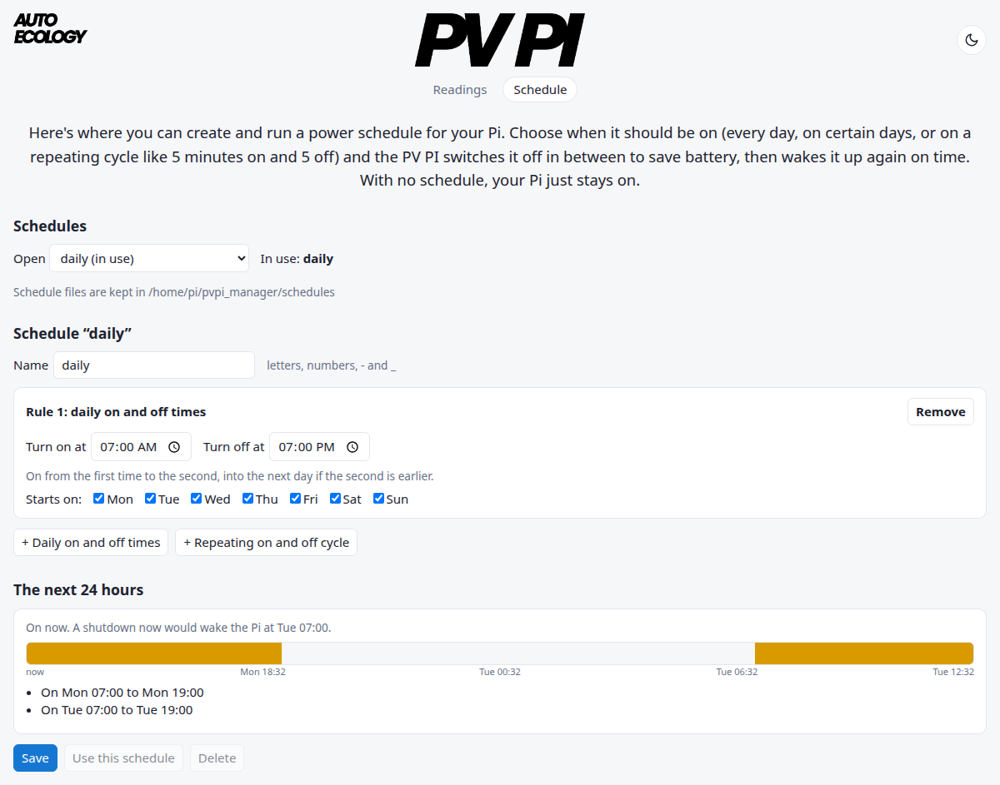

[Home](Home.md)

# Scheduling

A schedule sets the times your Pi is on. In between, the manager shuts it down and sets the PV Pi's wake alarm to boot your device at the set time. With no schedule, your Pi just stays on (and only shuts down when the battery runs low).

The easiest way to create a schedule, is by using the Schedule page on the [dashboard](Services-and-dashboard.md). You can select an existing schedule or create a new one and visualise the next 24 hours.



## Schedule files

Each schedule is a JSON file in the `schedules` folder. Your Pi is on whenever any of its rules is on. There are two kinds:

- `daily`: on from one time to another (into the next day if `off` is earlier than `on`)
- `periodic`: on and off in turn, e.g. 5 minutes on, 5 off, between `start` and `end` (all day if they're the same)

Both take `days`, the days a rule starts on (every day if left out). For example, `schedules/field.json`:

```json
{"rules": [
  {"kind": "daily", "on": "07:00", "off": "12:00", "days": ["mon", "tue", "wed", "thu", "fri"]},
  {"kind": "periodic", "on_for_mins": 5, "off_for_mins": 5, "start": "12:00", "end": "19:00"}
]}
```

To use it, set `"schedule": "field"` in your [config](Configuration.md). Changes are picked up within 10 seconds, no restart needed.

The repo comes with a few to start from: `daytime`, `weekdays_office_hours`, `dawn_and_dusk`, `night_only`, `every_10_minutes` and `daytime_duty_cycle`. (Installed with pip? Your `schedules` folder starts empty.)

A schedule is refused if an on time is too short for the Pi to start up (`startup_delay` + 60 s), or an off time too short for it to shut down and power off (`power_off_delay` + 60 s).

## Without a network

The schedule follows your Pi's clock. Out in the field with no network, turn on `time_mcu2pi` so your Pi takes the time from the PV Pi when it starts, and set the PV Pi's clock once with `uv run pvpi set-mcu-clock`.

## From the command line

```shell
uv run pvpi schedule          # the next 24 hours of the schedule in use
uv run pvpi schedule field    # or of another schedule
```

Older configs with `schedule_time`, `shutdown_time` and `wakeup_time` are refused: put those times in a `daily` rule instead (`on` = the old `wakeup_time`, `off` = the old `shutdown_time`).

Next: [Power log](Power-log.md)
