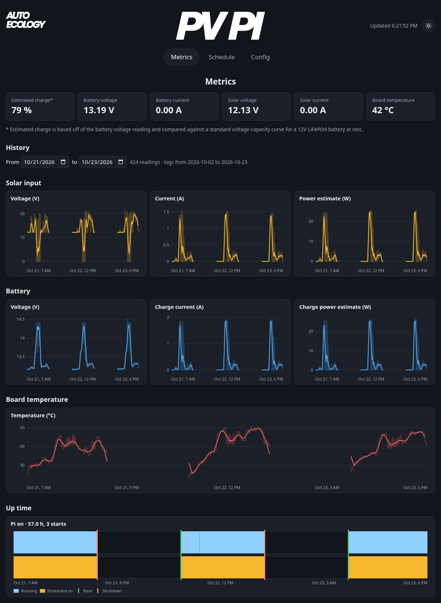

[Home](Home.md)

# Services and dashboard

pvpi_manager can run in the background as system services, starting every time your Pi boots. Install them with:

```shell
uv run pvpi install
```

That gives you two services, or three with the dashboard:

- **UART proxy** (`pvpi_uart`): holds the serial connection to the PV Pi, so several programs can talk to it at once. It only listens on the Pi itself (`tcp://127.0.0.1:5555`).
- **Manager** (`pvpi_manager`): looks after your Pi's power. It checks the battery every 10 seconds and shuts the Pi down after a few low readings in a row (so a short dip doesn't), follows your [schedule](Scheduling.md), and keeps the logs.
- **Dashboard** (`pvpi_dashboard`, optional): a small web page with live readings, history charts and the schedule.

None of them are needed to use the PV Pi from your own code. Each can also be run by hand, e.g. `uv run pvpi dashboard`.

## The dashboard

The dashboard is not installed by default, install it with:

```shell
uv run pvpi install --dashboard
```

Then open `http://<your-pi>:8501` (e.g. `http://raspberrypi.local:8501`) on the same network. It's light-weight enough to run alongside your own programs, even on a Pi Zero. There's no login, so anyone who can reach port 8501 can change your schedule, edit your config or sync the PV Pi clock or restart the PV Pi services.



The **Config** tab edits your existing `config.json` through a form. Settings are checked
before saving, including whether the active schedule still works with the new settings.
If the config changed since you opened the form, reload it before saving. Choose the active
schedule on the **Schedule** tab. The buttons above the settings let you **Save** the config, **Reload** the saved settings,
and **Restart** the PV Pi services to apply all settings. Save or reload unsaved edits before
restarting. Restart reloads the dashboard settings and restarts the UART proxy and manager.
The dashboard user needs permission to run `sudo -n systemctl restart pvpi_uart.service pvpi_manager.service`
(or run the dashboard as root). Restart failures are shown on the page.

The **Schedule** tab also shows the PV Pi and Raspberry Pi clocks in the Pi's local time.
**Sync Raspberry Pi time to PV Pi** copies the Raspberry Pi's clock to the PV Pi, like
`uv run pvpi set-mcu-clock`. Make sure the Raspberry Pi's time is correct first.
The clocks refresh every ten seconds while the page is visible.

The history charts need `log_pvpi_stats` on. To take the dashboard off again: `uv run pvpi install --no-dashboard`. Running `pvpi install` again (e.g. after an update) leaves it as you set it up.

Next: [Scheduling](Scheduling.md)
